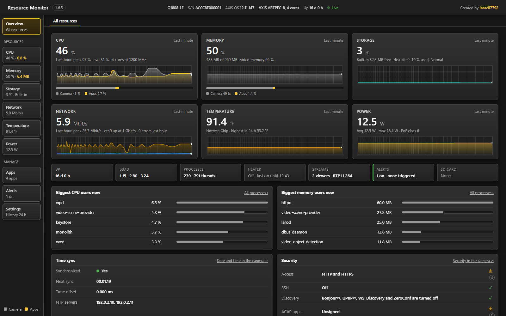
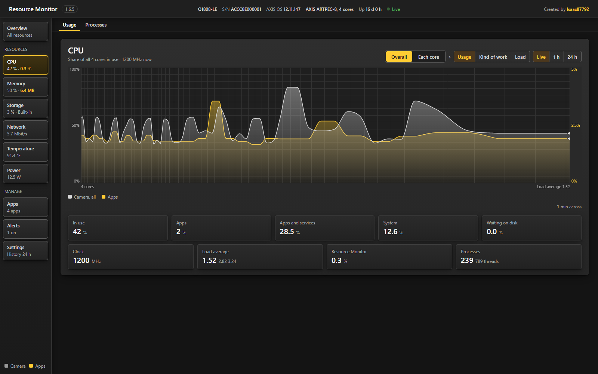
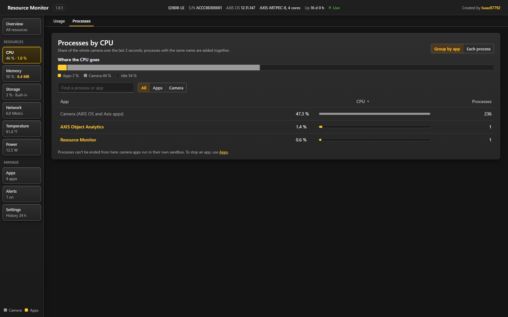
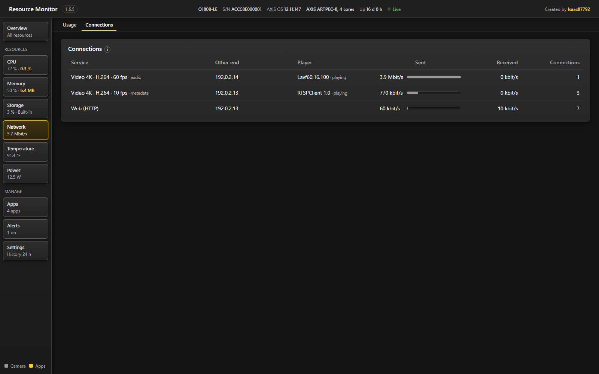
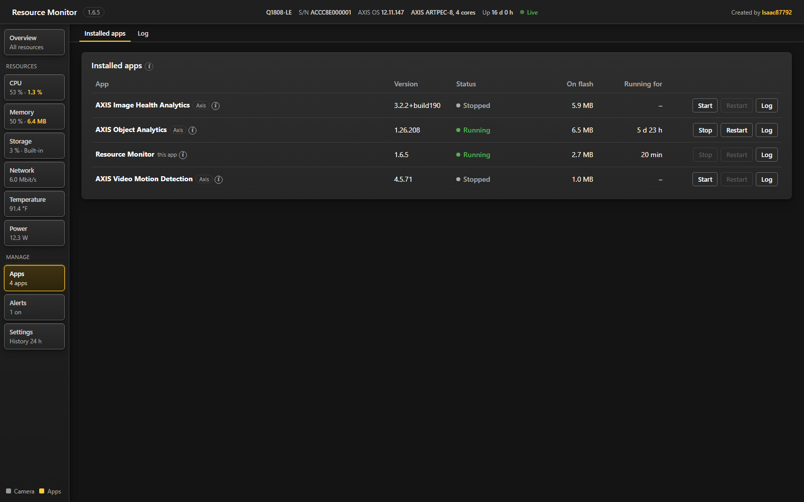
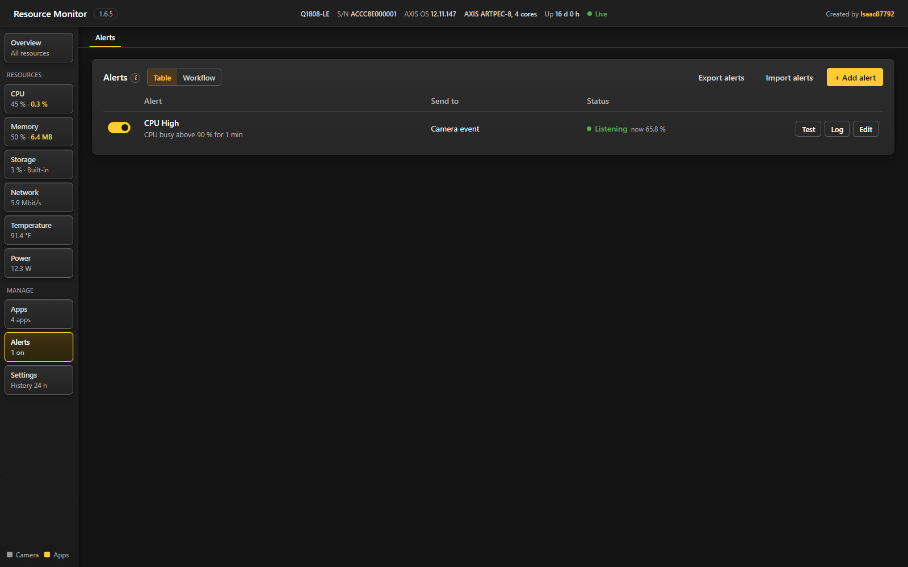
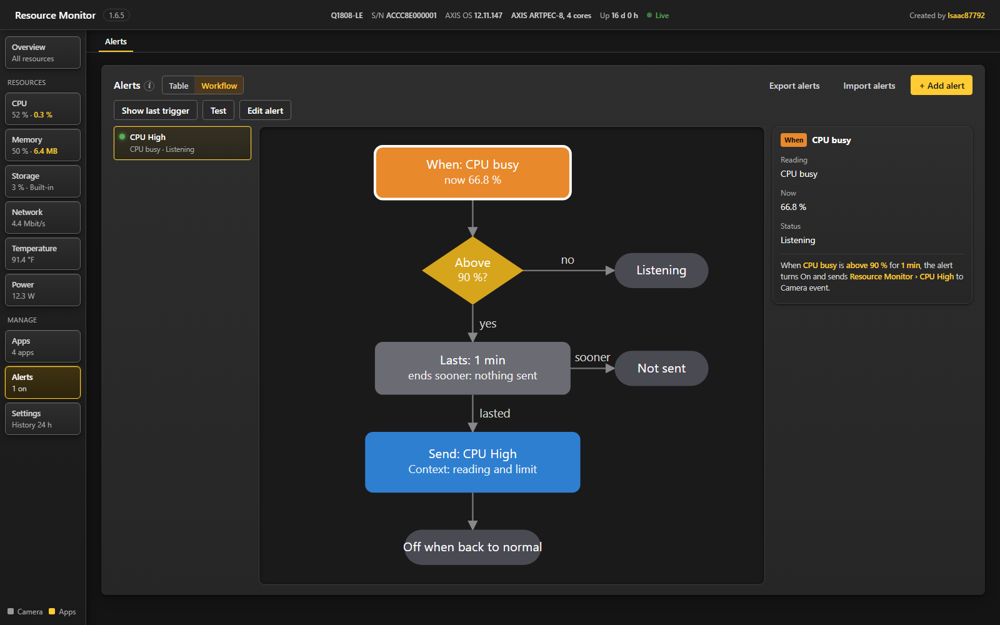
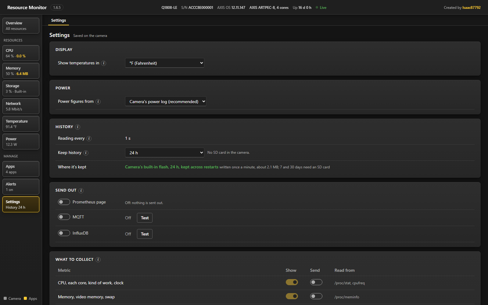

### Tip up front:  
If you want to download the acap for this already packaged, look under 'Releases' for "Resource_Monitor_x.x.x.zip". Download it, unzip it, upload it to your device and start it.

# Resource Monitor for Axis cameras

**A task manager that runs inside your Axis camera.** Resource Monitor is an ACAP app that shows, live and over time, what the camera is doing: CPU, memory, storage, network, temperature, power and the AI chip, and which processes and apps are using them. It answers "why is this camera slow, hot or busy?" from the camera's own web page, with nothing else to install.

## Why use it

- **See the cause, not just the symptom.** Every graph splits the load between the camera itself and the installed apps, so you can tell at a glance whether a third-party app or the camera's own work is behind a spike.
- **Look back.** History is kept for 24 hours in memory, and for 7 or 30 days on an SD card, so you can see what happened overnight, not only what is happening now.
- **Act on it.** Start, stop and restart apps from the same page. Every action asks first and is logged with the user who did it.
- **Feed your own tools.** Send readings and alerts to Prometheus, MQTT (with Home Assistant discovery) or InfluxDB, or as camera events to your VMS.

## Key features

### Overview dashboard
One page with a live tile per resource (each opens its own page), status chips for uptime, load, processes, heater, video streams, alerts and SD card, the biggest CPU and memory users right now, and the camera's time sync and security state (HTTPS, SSH, discovery protocols, unsigned apps) with a link to the matching camera setting.

### Resource pages
| Resource | What you see |
| --- | --- |
| **CPU** | Overall or per core; usage, kind of work (apps, system, waiting on disk) and load average; clock speed |
| **Memory** | Used, free and video memory; biggest users |
| **Storage** | Built-in flash and SD card: space, activity, health and wear, and which apps store data on each drive |
| **Network** | Traffic per interface, errors, and every connection: who is watching which stream, with the bytes of each TCP connection |
| **Temperature** | Every sensor the camera reports, and the heater state; shown in °C or °F |
| **Power** | Live draw and PoE class, with 7 and 30 day history from the camera's own power log |
| **AI chip** | Deep-learning processor activity, on cameras that have one |

Each graph can show **Live** (the last minute, newest on the right, older seconds squeezed to the left), **1 h** or **24 h**, and up to 30 days with an SD card.

### Processes
CPU, memory and storage each have a Processes page: every process, or grouped by app, with a bar showing where the resource goes (apps, camera, idle). Search by name, or filter to apps or the camera.

### Connections
Who is connected to the camera and what they are pulling: each video, audio and metadata stream with its player, and the traffic of each TCP connection.

### Apps
Every installed app with its version, status, size on flash and how long it has been running. Start, Stop and Restart (administrators only) ask first and are written to the app log with who did it and when. Changes made outside Resource Monitor are logged too.

### Alerts
An alert is a reading past its limit for a set time, for example "CPU above 90 % for 1 minute". Each alert can be sent as:
- a **camera event**, for your VMS or the camera's own Events › Rules;
- an **MQTT** message;
- an **InfluxDB** point;
- a **Prometheus** metric.

Every alert has a Test button (sends On, then Off 3 seconds later) and its own log of what happened and exactly what was sent.

- **Your own message:** each alert can send its own Context text, built from fields such as `{value}`, `{limit}`, `{unit}`, `{alert}`, `{state}`, `{count}` and `{camera}`, with simple formulas, for example `{alert} #{count} on {camera}: {value} {unit}`. The editor shows what the next alert would send. Without one, it sends the reading and the limit.
- **Workflow view:** each alert drawn as a flowchart (reading, limit, how long, where it goes), with the steps its last alarm reached.
- **Export and Import:** copy alerts from one camera to others with a file.

### Send out
- **Prometheus:** a `/metrics` page on the camera, ready to scrape.
- **MQTT:** one JSON message per group (`…/cpu`, `…/memory`, …) plus an availability topic, with TLS, your own CA and Home Assistant discovery (about 15 sensors appear on their own).
- **InfluxDB:** 1.x or 2.x, with TLS and your own CA; a round that can't be sent is kept and retried.

Sending is off until you turn it on, and you choose per metric what is shown and what is sent.

## Built to be a good guest on the camera

- **Light:** runs at a lower priority than the camera's own work, and shows its own CPU and memory use so you can check it.
- **Bounded:** nothing grows without limit; the app watches its own memory and restarts itself cleanly if it ever passes its limit.
- **Collect only what you use:** a metric that is neither shown nor sent is not read at all.
- **Private by default:** process names and connection addresses are never sent out. Passwords and tokens can be replaced but are never shown again.
- **Uses the camera's own data first:** power history, time sync and security are read from the camera's own APIs rather than copied.
- **Respects camera roles:** viewers can look, operators can test alerts, and only administrators can change settings, alerts or apps.

## Requirements

- An Axis camera with an **ARTPEC-8 or newer** chip (aarch64).
- The camera setting **Allow unsigned apps** turned on (Apps › settings in the camera's web page).
- An SD card is optional: it lets history be kept for 7 or 30 days.

## Install

1. Download the latest `.eap` file from [Releases](../../releases).
2. In the camera's web page, open **Apps**, choose **Add app** and select the file.
3. Start **Resource Monitor** and open it.

## License

MIT. See [LICENSE](LICENSE).
